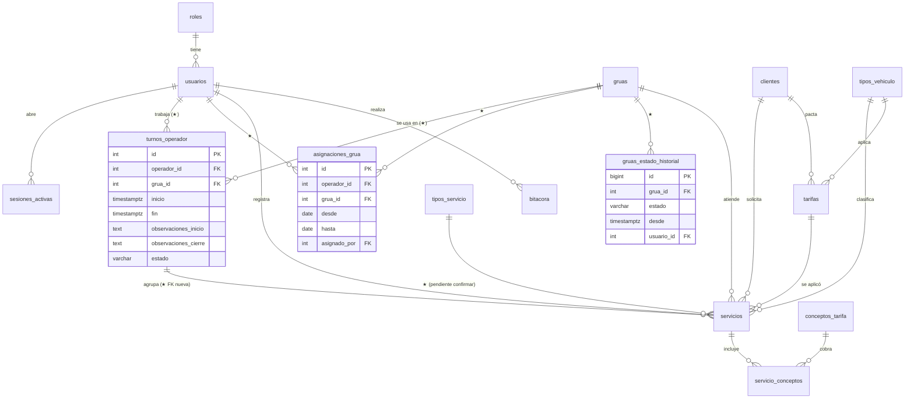

# GruaLink — Etapa 1: Análisis y arquitectura

> Fecha: 20/11/2026 · Estado: **pendiente de aprobación** · No se ha modificado código ni base de datos.

Este documento revisa lo que ya existe en `GruaLink/` (código y base de datos real) y propone cómo continuar.

---

## 0. Estado actual del proyecto (lo que ya existe)

Revisé el código y consulté la base de datos en modo **solo lectura**.

### Base de datos (PostgreSQL, ya creada)

| Tabla | Registros | Observación |
|---|---|---|
| roles | 3 | `administrador`, `operador`, `financiero` |
| usuarios | 2 | |
| clientes | 10 | **Tiene una columna extra `nombre_comercial`** que no está en el esquema del documento |
| tarifas | 9 | |
| servicios | 2 | |
| demás tablas | — | Coinciden con el esquema entregado |

No existe `turnos_operador` ni una carpeta `migrations/`: los cambios a la BD se han hecho a mano y no quedan registrados.

### Backend (Express 5, MVC, CommonJS) — base sólida

Ya funciona: login con bcrypt, sesiones en `sesiones_activas` con expiración, middleware `autenticar`, permisos por rol (`requierePermiso`), validación con express-validator, Helmet, rate-limit en login, transacciones (`withTransaction`), bitácora al crear servicios, selección de tarifa que **rechaza** tarifas ambiguas, y una capa de "vista" (`views/serializers.js`) que oculta valores económicos al operador. Es buena arquitectura; la mantendremos.

### Frontend (React 19 + Vite + MUI 9 + Axios + React Router 7)

Existen: login, inicio, formulario de servicio en 3 pasos (cliente / vehículo / resumen), listado, detalle, panel y monitoreo. Todo comparte un único `LayoutPrincipal`; aún no hay separación real entre la interfaz de escritorio y la móvil.

### Problemas encontrados en el código existente

| # | Archivo | Problema | Gravedad |
|---|---|---|---|
| 1 | `backend/services/servicio.service.js` + `models/servicio.model.js` | Se hace `...datos` con el body completo y el modelo acepta columnas como `valor_conceptos`, `fin_turno_real`, `hora_solicitud`. **Un operador puede enviar `valor_conceptos` desde Postman y quedaría guardado.** | Alta (seguridad económica) |
| 2 | `backend/validators/servicio.validator.js` y `servicio.service.js:33` | El cliente puede enviar `numero_orden`; si no, se genera `OS-<milisegundos>` (no consecutivo, posible colisión). El requerimiento dice que el número se genera en el servidor. | Alta |
| 3 | `servicio.service.js` | `grua_id` y `fecha_servicio` vienen del celular sin validarse contra el turno. El operador podría usar otra grúa o retrodatar la fecha para que aplique una tarifa antigua. | Alta |
| 4 | `backend/models/servicio.service.js` y `backend/models/tarifa.service.js` | Archivos duplicados y obsoletos (las versiones vigentes están en `services/`). `models/tarifa.service.js` tiene su contenido **pegado dos veces** → daría `SyntaxError` si alguien lo importa. | Media (confusión) |
| 5 | `servicio.service.js` | Los conceptos adicionales nunca se guardan en `servicio_conceptos`; `valor_conceptos` siempre queda en 0. | Media |
| 6 | `routes/servicio.routes.js` | Las rutas GET exigen `servicios:ver_propios`, que el rol `financiero` no tiene → el financiero recibe 403 al listar. | Media |
| 7 | `controllers/auth.controller.js` | Si llega login sin `password`, `bcrypt.compare(undefined, …)` lanza error → 500 en vez de 422. Falta validador de login. | Baja |
| 8 | `middlewares/errorHandler.js` | Errores de PostgreSQL (único duplicado `23505`, FK `23503`, CHECK `23514`) salen como 500 genérico. Deben traducirse a 409/422 con mensaje claro. | Media |
| 9 | `frontend/src/pages/PanelPage.jsx` | Los indicadores se calculan **en el navegador** sobre los primeros 200 servicios → con más datos el dashboard miente. Deben venir de consultas SQL agregadas. | Alta (requisito) |
| 10 | `PanelPage.jsx` | Usa `<Grid item xs=…>`, sintaxis de la Grid antigua. En MUI 7+ (tienes la 9) es `<Grid size={{ xs: 12, md: 3 }}>`. Probablemente el layout no se ve como se espera. | Baja |
| 11 | `frontend/src/api/client.js` | Token en `localStorage`: expuesto si hubiera XSS. Aceptable en esta fase; alternativa en Etapa 7: cookie `httpOnly`. | Baja (por ahora) |
| 12 | `backend/.gitignore` vacío; la carpeta no es repositorio git | `.env` (contraseña de BD) y `node_modules` no están protegidos; no hay historial para revertir cambios. | Media |
| 13 | Proyecto dentro de **OneDrive** | OneDrive sincroniza ~56.000 archivos de `node_modules`; causa lentitud y bloqueos de archivos en `npm install`. | Media (operativa) |

---

## 1. Resumen de la arquitectura propuesta

```text
 Celular (operador)            Computador (admin / financiero)
        │                                │
        └──────────┐          ┌──────────┘
                   ▼          ▼
         Frontend único: React + Vite + MUI
         ├─ /app/*    → interfaz móvil (OperadorLayout, navegación inferior)
         └─ /admin/*  → panel escritorio (AdminLayout, menú lateral)
                   │  HTTPS + Bearer token (Axios)
                   ▼
         API REST: Node + Express 5 (MVC)
         routes → middlewares (auth, rol, validación) → controllers
                → services (reglas de negocio, tarifas, turnos)
                → models (SQL parametrizado) → views (qué ve cada rol)
                   │  pg (Pool + transacciones)
                   ▼
         PostgreSQL (fuente única de verdad, bitácora, restricciones)
```

**Decisiones clave**

1. **Un solo proyecto frontend con dos layouts**, no dos apps. Comparten login, cliente HTTP, tema y componentes; tras el login se redirige según rol (`operador` → `/app`, resto → `/admin`). Menos código duplicado y un solo despliegue. La parte móvil se diseña aparte (mobile-first), no es el escritorio reducido. Más adelante se puede convertir en PWA (instalable en el celular) sin cambiar tecnología.
2. **La lógica de negocio vive en `services/`** del backend (tarifas, turnos, transiciones de estado). Los controladores solo traducen HTTP ↔ servicio.
3. **La BD se protege a sí misma** con restricciones (índices únicos parciales, CHECK, exclusión de rangos), no solo con código: aunque haya un bug en Node, PostgreSQL rechaza datos inválidos.
4. **Lista blanca de campos por operación**: cada endpoint declara qué campos acepta del cliente; todo lo demás (operador, grúa, número de orden, valores, estado, fechas del servidor) lo pone el backend.
5. **Migraciones numeradas** en `backend/migrations/` aplicadas por un script propio (`npm run migrate`) que registra cuáles ya corrieron en una tabla `schema_migrations`. Sin dependencias nuevas.

---

## 2. Diagrama entidad-relación (actualizado)

Las entidades **nuevas** están marcadas con ★. Se puede ver renderizado en VS Code (extensión *Markdown Preview Mermaid*) o en GitHub.



Tablas existentes sin cambios estructurales: `roles`, `sesiones_activas`, `tipos_vehiculo`, `servicio_conceptos`.

---

## 3. Campos o tablas faltantes

**No ejecutaré ninguna de estas migraciones hasta que confirmes las preguntas de la sección 9.** Abajo, el SQL propuesto y qué problema resuelve.

### 3.1 `turnos_operador` (requerida)

```sql
CREATE TABLE turnos_operador (
  id SERIAL PRIMARY KEY,
  operador_id INT NOT NULL REFERENCES usuarios(id),
  grua_id INT NOT NULL REFERENCES gruas(id),
  inicio TIMESTAMPTZ NOT NULL DEFAULT now(),      -- hora del SERVIDOR
  fin TIMESTAMPTZ,
  observaciones_inicio TEXT,
  observaciones_cierre TEXT,
  estado VARCHAR(20) NOT NULL DEFAULT 'activo'
    CHECK (estado IN ('activo','finalizado','cerrado_admin')),
  cerrado_por INT REFERENCES usuarios(id),        -- si lo cerró un admin
  CHECK ((estado = 'activo') = (fin IS NULL)),    -- activo ⇔ sin hora de fin
  CHECK (fin IS NULL OR fin >= inicio)
);

-- Un operador no puede tener dos turnos activos
CREATE UNIQUE INDEX ux_turno_activo_operador
  ON turnos_operador (operador_id) WHERE estado = 'activo';

-- Una grúa no puede estar en dos turnos activos (si la regla se confirma)
CREATE UNIQUE INDEX ux_turno_activo_grua
  ON turnos_operador (grua_id) WHERE estado = 'activo';
```

- **Problema que resuelve:** hoy no hay forma de saber quién trabajó, con qué grúa y cuándo empezó/terminó la jornada.
- **Por qué índice único parcial:** aunque dos peticiones lleguen al mismo milisegundo, PostgreSQL rechaza la segunda (error `23505`) — el código Node no puede garantizar eso solo.
- `cerrado_admin`: para el caso real de un operador que olvida cerrar turno; el admin lo cierra con motivo en bitácora.
- **Distinto de `servicios.fin_turno_real`**, que se refiere al servicio (ver pregunta P5).

### 3.2 Vincular servicio ↔ turno

```sql
ALTER TABLE servicios ADD COLUMN turno_id INT REFERENCES turnos_operador(id);
CREATE INDEX idx_servicios_turno ON servicios (turno_id);
```

Resuelve: saber en qué jornada se hizo cada servicio y validar que el servicio se registró con turno activo. Nullable para no romper los 2 servicios ya existentes.

### 3.3 Asignación de grúa al operador

El requerimiento dice "consultar la grúa asignada" y "no puede cambiarla por su cuenta", pero **no existe dónde guardar esa asignación**. Propuesta:

```sql
CREATE TABLE asignaciones_grua (
  id SERIAL PRIMARY KEY,
  operador_id INT NOT NULL REFERENCES usuarios(id),
  grua_id INT NOT NULL REFERENCES gruas(id),
  desde DATE NOT NULL,
  hasta DATE,
  asignado_por INT NOT NULL REFERENCES usuarios(id),
  creado_en TIMESTAMPTZ NOT NULL DEFAULT now(),
  CHECK (hasta IS NULL OR hasta >= desde)
);
CREATE UNIQUE INDEX ux_asignacion_vigente_operador
  ON asignaciones_grua (operador_id) WHERE hasta IS NULL;
```

Al iniciar turno, el backend toma la grúa de aquí; el celular **no** la envía. (Depende de la pregunta P3.)

### 3.4 Historial de estado de grúas

El dashboard "Promedio de grúas" muestra cuántas grúas estaban en operación/mantenimiento **cada día pasado**. Con `gruas.estado` solo se conoce el estado *de hoy*: no se puede calcular el promedio histórico. Propuesta:

```sql
CREATE TABLE gruas_estado_historial (
  id BIGSERIAL PRIMARY KEY,
  grua_id INT NOT NULL REFERENCES gruas(id),
  estado VARCHAR(20) NOT NULL CHECK (estado IN ('activa','inactiva','mantenimiento')),
  desde TIMESTAMPTZ NOT NULL DEFAULT now(),
  usuario_id INT REFERENCES usuarios(id),
  motivo TEXT
);
```

"En operación" en un día = grúas con al menos un turno activo ese día (se deriva de `turnos_operador`, no se guarda).

### 3.5 Tarifas: evitar rangos superpuestos

```sql
CREATE EXTENSION IF NOT EXISTS btree_gist;
ALTER TABLE tarifas ADD CONSTRAINT tarifas_sin_superposicion
  EXCLUDE USING gist (
    cliente_id WITH =,
    tipo_vehiculo_id WITH =,
    numrange(km_desde, km_hasta, '[]') WITH &&,
    daterange(vigente_desde, vigente_hasta, '[]') WITH &&
  );
```

Resuelve: dos tarifas que cubren el mismo km y la misma fecha para el mismo cliente/vehículo. **Antes de aplicarla hay que verificar que las 9 tarifas actuales no se superpongan** (si se superponen, la migración falla y te muestro cuáles).

⚠️ **Hueco entre rangos:** con tu ejemplo (0–10, 10,01–15), un servicio de **10,005 km** no cae en ningún rango. Solución: el backend redondea los km facturables a 2 decimales *antes* de buscar la tarifa (la columna ya es `NUMERIC(8,2)`). Ver P8.

### 3.6 Conceptos de tarifa: versiones

`conceptos_tarifa.nombre` es `UNIQUE`, pero la tabla tiene `vigente_desde/hasta`. **Contradicción:** no se puede crear "Km adicional 2027" con el mismo nombre para cambiar su precio. Opciones: (a) quitar el UNIQUE de `nombre` y poner exclusión por vigencia como en tarifas, o (b) separar `conceptos` (catálogo) de `conceptos_valores` (precio por vigencia y, si aplica, por cliente). Depende de P9.

### 3.7 Campos de servicio que aparecen en el requerimiento/maquetas pero no en la tabla

| Dato pedido | Situación | Propuesta |
|---|---|---|
| Tipo de servicio (Remolque, etc.) | No existe; solo `es_rescate` | Tabla `tipos_servicio` + `servicios.tipo_servicio_id` (P6) |
| Teléfono de contacto del servicio | Solo existe `clientes.telefono` | `servicios.contacto_telefono` si es por servicio (P7) |
| Observaciones del vehículo / adicionales / de entrega | Un solo campo `observaciones` | `servicios.observaciones_entrega TEXT` (y mantener `observaciones`) |
| Quién aprobó y cuándo | Solo en bitácora | `servicios.aprobado_por`, `servicios.aprobado_en` (consultas de reportes más simples) |
| Número de orden consecutivo | `OS-<ms>` | `CREATE SEQUENCE servicios_numero_orden_seq` y formato definido en P4 |

### 3.8 Bitácora

- `operacion` solo admite `crear, actualizar, anular, autorizar_correccion`. Faltan `aprobar`, `iniciar_turno`, `finalizar_turno`, `finalizar_servicio`, `login`. Propuesta: ampliar el CHECK.
- Debe ser **solo inserción**: en producción el usuario de BD de la API no tendrá permiso `UPDATE`/`DELETE` sobre `bitacora`.

### 3.9 Otros

- `clientes.nombre_comercial` ya existe en la BD real → la registro como migración `000` ("estado base") para que quede documentado.
- `sesiones_activas`: índice en `usuario_id` y tarea de limpieza de sesiones vencidas.
- Zona horaria: fijar `timezone = 'America/Bogota'` en la conexión, para que `fecha_servicio` (DATE) no cambie de día después de las 7 p. m.

---

## 4. Estructura del frontend

```text
frontend/src/
├── api/                    # (ya existe) un archivo por recurso: auth, servicios, turnos, tarifas…
├── assets/                 # logo GruaLink
├── components/
│   ├── comunes/            # EstadoChip, ConfirmDialog, TablaPaginada, CampoFecha…
│   ├── admin/              # KpiCard, GraficoPromedio, FiltrosReporte…
│   └── operador/           # TarjetaAccion, PasoCliente, PasoVehiculo, PasoServicio,
│                           # PasoOperativo, PasoResumen (los actuales se mueven aquí)
├── context/AuthContext.jsx # (ya existe)
├── hooks/                  # useApi, useTurnoActivo, useCatalogos
├── layouts/
│   ├── AdminLayout.jsx     # menú lateral azul oscuro + barra superior
│   └── OperadorLayout.jsx  # barra superior + navegación inferior (Inicio/Servicios/Historial/Perfil)
├── pages/
│   ├── LoginPage.jsx       # compartido; redirige por rol
│   ├── admin/              # Dashboard, Servicios, Solicitudes, Tarifas, Clientes, Gruas,
│   │                       # Usuarios, Reportes/*, Bitacora, Configuracion
│   └── operador/           # Inicio, InicioTurno, FinTurno, NuevoServicio, MisServicios,
│                           # DetalleServicio, FinalizarServicio, HistorialTurnos, Perfil
├── routes/
│   ├── AppRouter.jsx       # define /admin/* y /app/*
│   └── RutaProtegida.jsx   # (se extrae de App.jsx)
├── theme/tema.js           # (ya existe) colores de las maquetas
└── utils/                  # formatoMoneda, formatoFecha, etiquetas de estado
```

Las páginas actuales (`OrdenServicioPage`, `ListadoOrdenesPage`, etc.) se **reubican y amplían**, no se borran.

## 5. Estructura del backend

```text
backend/
├── config/db.js              # (ya existe) + zona horaria
├── controllers/              # auth, servicios, turnos, tarifas, conceptos, clientes,
│                             # gruas, usuarios, dashboard, reportes, bitacora
├── middlewares/              # (ya existen) auth, permisos, errorHandler (+ traducción errores pg)
├── models/                   # SOLO SQL. Se eliminan los *.service.js duplicados de aquí
├── services/                 # reglas de negocio: servicio, tarifa, turno, numeracion
├── validators/               # uno por recurso + listas blancas de campos
├── views/serializers.js      # (ya existe) qué campos ve cada rol
├── routes/                   # un router por recurso
├── migrations/               # 000_estado_base.sql, 001_turnos.sql, … + run.js
├── seeds/                    # datos de prueba (solo desarrollo)
├── tests/                    # node:test (ya configurado en package.json)
└── server.js
```

---

## 6. Matriz de permisos por rol

✔ = permitido · 👁 = solo lectura · — = sin acceso · (propios) = solo los suyos

| Recurso / acción | Administrador | Operador | Financiero (futuro) |
|---|---|---|---|
| Login / logout / perfil propio | ✔ | ✔ | ✔ |
| Usuarios: crear, editar, desactivar | ✔ | — | — |
| Clientes: CRUD (desactivar, no borrar) | ✔ | 👁 activos (para el formulario) | 👁 |
| Grúas: CRUD y estado | ✔ | 👁 la asignada | 👁 |
| Asignar grúa a operador | ✔ | — | — |
| Tipos de vehículo / servicio | ✔ | 👁 | 👁 |
| Tarifas y conceptos: CRUD | ✔ | — | 👁 |
| Turno: iniciar / finalizar propio | — | ✔ (propios) | — |
| Turno: cerrar turno olvidado | ✔ (con motivo) | — | — |
| Historial de turnos | 👁 todos | 👁 propios | — |
| Servicio: registrar | ✔ (ver P2) | ✔ con turno activo | — |
| Servicio: ver | 👁 todos | 👁 propios, **sin valores $** | 👁 todos |
| Servicio: finalizar | ✔ | ✔ propios, solo una vez | — |
| Servicio: editar después de guardado | ✔ corrección con motivo → bitácora | — | — |
| Servicio: aprobar / fijar valor aprobado | ✔ | — | — (ver P10) |
| Servicio: anular | ✔ con motivo | — | — |
| Servicio: eliminar | — (nadie; se anula) | — | — |
| Dashboard y reportes | ✔ | — | 👁 |
| Bitácora | 👁 | — | — |
| Configuración | ✔ | — | — |

Todo se aplica en el **backend** (`requierePermiso` + filtro por `operador_id` en SQL + serializer); el frontend solo oculta botones como comodidad.

---

## 7. Flujo de trabajo del administrador

1. **Configuración inicial:** crea clientes → tipos de vehículo → grúas → usuarios operadores → asigna grúa a cada operador → carga tarifas por cliente/vehículo/rango/vigencia → carga conceptos adicionales.
2. **Operación diaria:** abre el dashboard (grúas en turno, servicios del día por estado). Revisa *Solicitudes* (si existen, ver P1) y *Servicios*.
3. **Revisión:** filtra servicios `finalizado`, abre cada uno, verifica km, conceptos y datos de entrega → lo pasa a `en_revision` → si todo está bien, fija `valor_aprobado` y lo pasa a `aprobado`. Si hay un error, hace **corrección autorizada**: escribe el motivo, el sistema guarda valores anteriores y nuevos en `bitacora` y recalcula la tarifa.
4. **Excepciones:** anula servicios con motivo; cierra turnos olvidados.
5. **Cierre de periodo:** consulta reportes por cliente/operador/grúa y exporta.

## 8. Flujo del operador (celular)

```text
Login ──► Inicio
           │ ¿turno activo? ── No ──► [Iniciar turno] (grúa asignada viene del servidor,
           │                           hora del servidor, observaciones) ──► Inicio
           ▼ Sí
   ┌───────┼────────────┬──────────────┬───────────────┐
 Nuevo servicio   Mis servicios   Historial turnos   Finalizar turno
   │                 │                                 │
 1 Cliente           ├─ ver detalle (solo lectura)     ├─ ¿servicios sin cerrar? → avisa / pide justificación
 2 Vehículo          └─ Finalizar servicio             └─ hora servidor + observaciones → estado finalizado
 3 Servicio             (hora fin, km, entrega,
 4 Operativo             receptor) → bloqueado
 5 Resumen → Confirmar
   │
   └─► Backend: valida turno activo, toma operador y grúa de la sesión/turno,
       genera Nº de orden, calcula tarifa, guarda, registra bitácora → "Orden #000124 guardada"
```

El paso 4 (operativo) puede llenarse al crear o al finalizar, según la respuesta a P1.

---

## 9. Riesgos, inconsistencias y **preguntas que necesito que respondas**

No voy a inventar reglas de negocio. Estas respuestas cambian la BD o la lógica:

| # | Pregunta | Por qué importa |
|---|---|---|
| **P1** | ¿El operador registra el servicio **cuando lo recibe** (y luego avanza: asignado → en desplazamiento → en servicio → finalizado) o lo registra **cuando ya lo terminó** (como hoy con la remisión en papel)? | Define si el formulario de 5 pasos se llena de una vez o en dos momentos, y qué estados usa el operador. Las maquetas muestran ambos. |
| **P2** | ¿Quién crea las "Solicitudes" del menú admin? ¿El admin recibe llamadas y asigna el servicio a un operador? | Si sí, existe un flujo admin → operador que hoy no está descrito. |
| **P3** | ¿La grúa del operador es **fija** (asignada por el admin) o el operador **elige** la grúa al iniciar turno? ¿Puede una grúa tener dos operadores en el mismo turno (conductor + auxiliar)? | Decide si se crea `asignaciones_grua` y si se aplica `ux_turno_activo_grua`. |
| **P4** | Formato del número de orden: ¿`000123`, `OS-2026-000123`? ¿Debe continuar la numeración de las remisiones en papel? ¿Desde qué número? | Secuencia de PostgreSQL. |
| **P5** | ¿Qué significan exactamente `ingreso_programado`, `salida_programada` y `fin_turno_real` en un **servicio**? ¿Quién los llena? | Están en la tabla pero no en el requerimiento ni en las maquetas. No los toco hasta saberlo. |
| **P6** | Tipos de servicio: ¿cuáles existen (remolque, rescate, traslado…)? ¿Afectan la tarifa? | Hoy la tarifa no depende del tipo de servicio. |
| **P7** | Teléfono de contacto: ¿es el del cliente (fijo) o el de la persona que pide ese servicio? | Campo nuevo o no. |
| **P8** | **Km facturables:** ¿= km de servicio? ¿km servicio + km en vacío? ¿hay mínimo? ¿se redondea? El código actual usa "km servicio" como regla **provisional**. | Determina qué rango tarifario aplica. |
| **P9** | Conceptos adicionales: ¿su precio es **igual para todos los clientes** o cambia por cliente? ¿Quién los agrega al servicio: el operador (ej. "usé kit antiderrames") o solo el admin al revisar? | Estructura de `conceptos_tarifa` y permisos. |
| **P10** | Concepto tipo **porcentaje**: ¿porcentaje sobre qué base (tarifa básica, total)? | Hoy el código lo deja en 0. |
| **P11** | `porcentaje_operador`: ¿es la comisión del operador? ¿Cómo se calcula y quién la ve? | Campo existente sin regla. |
| **P12** | ¿El operador debe ver **algún** valor en pesos? (La maqueta "Detalle del servicio" muestra $650.000 y "Total estimado".) | Hoy el serializer los oculta al operador. |
| **P13** | ¿Se puede registrar un servicio de un **día anterior** (ej. olvidó registrarlo ayer)? ¿Con qué límite? | Riesgo de retrodatar para cambiar tarifa. |
| **P14** | ¿Las grúas tienen buena señal siempre? ¿Se necesita registrar **sin internet** y sincronizar después? | Cambia mucho la arquitectura móvil (offline/PWA). Propongo dejarlo para una fase posterior si no es crítico. |

**Riesgos técnicos adicionales**

- Rate-limit de login por IP (10 / 15 min): si varios operadores salen por la misma IP (Wi-Fi de la base o red del operador móvil), pueden bloquearse entre ellos. Se ajustará por IP + correo.
- Sin git no hay forma de revertir un cambio que salga mal. Recomiendo `git init` antes de la Etapa 2.
- Proyecto en OneDrive (ver tabla de la sección 0).
- La maqueta dice "Prom de Guas": se usará "Promedio de grúas".

---

## 10. Plan de desarrollo priorizado

| Orden | Etapa | Entregable verificable |
|---|---|---|
| 0 | Higiene | `git init`, `.gitignore` (excluir `.env`, `node_modules`), borrar duplicados de `models/*.service.js`, corregir bug #1 (lista blanca) |
| 1 | **Etapa 2 — BD** | `migrations/` + `run.js`; migración 000 (estado base), 001 turnos, 002 servicios.turno_id + campos confirmados, 003 exclusión de tarifas, 004 bitácora ampliada; seeds de prueba. Prueba: consultas SQL que intentan violar cada restricción y deben fallar. |
| 2 | **Etapa 3 — Backend núcleo** | Auth reforzado → turnos (iniciar/finalizar) → servicios (crear con turno, numeración, tarifa + conceptos, finalizar una vez) → tests `node:test` de permisos y cálculo. |
| 3 | Etapa 3 — Backend admin | CRUD clientes, grúas, usuarios, tarifas, conceptos; aprobación y corrección con bitácora; endpoints de dashboard con SQL agregado. |
| 4 | **Etapa 5 — Móvil** (antes que el admin, porque es lo que reemplaza el papel) | Login, inicio, turno, nuevo servicio 5 pasos, mis servicios, finalizar servicio/turno. Prueba en celular real. |
| 5 | Etapa 4 — Admin | Layout, dashboard, CRUDs, tarifas, revisión/aprobación, reportes, bitácora. |
| 6 | Etapa 6 — Integración | Pruebas de extremo a extremo por rol. |
| 7 | Etapa 7 — Producción | HTTPS, variables de entorno, usuario de BD con permisos mínimos, respaldos `pg_dump` programados, manual de instalación. |

**Propuesta de cambio de orden:** hacer la interfaz móvil (Etapa 5) antes que el panel admin (Etapa 4), porque es la que elimina la remisión en papel; mientras tanto el admin puede cargar tarifas y clientes con los seeds/SQL. Si prefieres el orden original, se respeta.

---

**Siguiente paso:** responde las preguntas P1–P14 (las que puedas; las demás quedan marcadas como provisionales) y aprueba este análisis para iniciar la **Etapa 2 (PostgreSQL)**.

---

## 11. Hallazgos del Excel actual (`REGISTRO TOTAL SERVICIOS DE GRUAS VIGENTE.xlsx`)

> Analizado el 20/11/2026 en modo solo lectura. Hojas: SERVICIOS, TB TARIFAS, Tfa trans, TB DINAMICA, DASHBOARD OPERACIONAL, TIEMPOS MANIOBRAS.

### 11.1 Volumen real

| Dato | Valor |
|---|---|
| Filas de servicio | **7.587** (4.264 en 2025, 3.317 en 2026 hasta el 19/11) |
| Filas que **no son servicios** (estado de grúa/operador) | 158: DISPONIBLE, CAPACITACIÓN, ANULADA, TALLER, VARADA, INCAPACIDAD, VACACIONES, SIN OPERADOR… |
| Grúas | 3 grúas propias hacen el 89 %: #1 XVV453 (3.892), #2 XVV429 (1.755), #5 RKL914 (1.098). Aparecen además grúas identificadas con letras (Y, D, S, P, Q, H, X, M) y ~49 placas distintas |
| Clientes | Sotramac 2.095, Suma 2.082, Transambiental 1.787 (≈78 %, Cartagena) + Capital Bus, SI18 (A/M/S), La Rolita, Masivo Capital… |
| Operadores | ~100 nombres distintos, pero muchos son el mismo escrito diferente ("Yamid Losada"/"Yamid losada", "Pablo Sierra"/"Pablo sierra") |
| Servicios con km = 0 | **72 %** → la mayoría se cobra con tarifa fija, no por km |
| Números de orden | 7.283 numéricos, **763 repetidos**, 304 sin número ("X", "S/O"); saltos documentados (8701–8800) |

**Conclusión:** a ~350 servicios/mes, PostgreSQL y la arquitectura propuesta sobran en capacidad. El reto no es volumen, es **calidad de datos**: catálogos cerrados en vez de texto libre.

### 11.2 Mapeo columna Excel → GruaLink

| Columna Excel | En GruaLink | Estado |
|---|---|---|
| # GRUA, Placa Grua | `gruas.numero_interno`, `gruas.placa` | ✔ existe |
| No. Orden de servicio | `servicios.numero_orden` | ✔ (ver P4 resuelta) |
| # DE FACTURA | — | ❗ falta (`numero_factura`) — lo llena el admin |
| Solicitud de compra | — | ❗ falta (`solicitud_compra`) — dato del cliente |
| Número de Vehículo | `numero_vehiculo` | ✔ |
| Tipo Vehiculo | `tipo_vehiculo_id` | ✔ catálogo: Buseton, Padrón, Biarticulado, Articulado, Buseta, Alimentador… |
| Empresa y/o cliente | `cliente_id` | ✔ |
| Operador Grua | `operador_id` | ✔ |
| **Entra / Sale** | `ingreso_programado` / `salida_programada` | ✔ **P5 resuelta:** es el horario del turno del operador (06:00–23:00, 15:00–22:00…) copiado en cada fila. Debe vivir en `turnos_operador`, no en cada servicio |
| **Termina turno** | `fin_turno_real` | ✔ **P5 resuelta:** hora real de fin de jornada → pasa a `turnos_operador.fin` |
| Fecha | `fecha_servicio` | ✔ |
| H.solicitado | `hora_solicitud` | ✔ |
| T. de reacción | calculado = inicio − solicitud (con cruce de medianoche) | se calcula, no se guarda |
| H. de inicio / H. de final | `inicio_servicio` / `fin_servicio` | ✔ (TIMESTAMPTZ resuelve el cruce de medianoche que en Excel requiere `IF(...<0, +1)`) |
| Tiempo total | calculado | se calcula |
| Origen / Destino | `origen` / `destino` | ✔ pero destino casi siempre es un **patio** (Patio Sotramac, Patio Prosperidad…) → propongo catálogo `patios` opcional + texto libre |
| Tal k. gps x día | — | casi vacío (10 filas); descartar o confirmar |
| KIL EN VACIO / K x svcio / Tal K | `km_vacio` / `km_servicio` / suma | ✔ |
| Tarifa | `valor_tarifa_basica` | ✔ |
| Cardán/Eje/Tubo, Persiana, Cámaras, Recargo nocturno/Stand-by, M. Rescate | `servicio_conceptos` | ✔ cada columna es un concepto |
| Tal. Tarifa a cobrar | `valor_calculado` | ✔ |
| % Porcentaje Op Grúa | `porcentaje_operador` | ✔ **P11 resuelta** (ver 11.4) |
| Observaciones | `observaciones` | ✔ hay frases repetidas ("Se retira cardán y se entrega en patio S/N") → plantillas rápidas en el celular |
| # Galones, $ Galón, V. Venta, FTRA Tercero | — | ❗ combustible y facturación de terceros: ¿entran en GruaLink? (P18) |

### 11.3 Las tarifas reales son distintas al esquema actual (importante)

La hoja TB TARIFAS muestra que una tarifa depende de:

**cliente** (o "Clientes generales" por defecto) + **concepto** + **cobertura** (Bogotá / Cartagena) + **operación** (Troncal / Zonal) + **año de vigencia**.

Tipos de concepto encontrados:

| Tipo | Ejemplos | Cómo se cobra |
|---|---|---|
| Básico por tipo de vehículo | Biarticulado $684.000, Articulado $393.000, Busetón $410.000 (2026, generales) | Valor fijo por evento |
| Básico por rango de km (solo La Rolita y terceros) | "<15 km" $480.000, "≥15 y <20" $548.000 … "más de 50" | Rango **semiabierto [desde, hasta)** |
| Adicional por evento | Desmontar cardán, Quitar persiana, Cámaras de freno, Kit antiderrames, Reiniciada | Fijo × cantidad |
| Por hora | Hora stand-by | Valor × horas (hay fracciones: "hora y media", "2 h 24 min") |
| Recargo nocturno | Corte a las 20:40 (Bogotá) o 19:00 (La Rolita, Cartagena) | Depende de la hora de finalización/inicio |
| Servicio fallido | Por tipo de vehículo | Fijo |
| A convenir | Rescate, Otros servicios | **Valor manual del admin** |
| Paquete mensual (Cartagena) | "Disponibilidad mensual por 90 servicios" $21.444.840 + "Valor unitario" $238.276 + "Servicio posterior a los 90" $143.000 | Cuota mensual |

**Consecuencias para la BD:**
- La tabla `tarifas` actual (cliente + tipo vehículo + km) cubre solo el caso La Rolita. Hay que generalizarla.
- `conceptos_tarifa` hoy es global (sin cliente) → no sirve: el cardán cuesta $92.400 general, $88.000 Capital Bus, $85.600 SI18, $46.100 Sotramac.
- **Propuesta (para tu aprobación):** una sola tabla de precios:

```sql
-- Catálogo de conceptos (qué se cobra)
conceptos (id, codigo, nombre, unidad_cobro, es_basico, aplica_tipo_vehiculo, requiere_valor_manual)
-- Precio de cada concepto según contexto y vigencia
tarifas_precio (id, concepto_id, cliente_id NULL = "Clientes generales",
                tipo_vehiculo_id NULL, cobertura, operacion,
                km_desde, km_hasta, valor, vigente_desde, vigente_hasta)
```

  Al calcular, el backend busca primero el precio del cliente y, si no existe, el de "Clientes generales". La exclusión de superposición (sección 3.5) se aplica sobre esta tabla.
- Hay que conservar `tarifas`/`conceptos_tarifa` actuales hasta migrar sus 9 registros (no se borran sin tu aprobación).

### 11.4 Fórmula real del porcentaje del operador (P11 resuelta)

Tomada de la columna AF del Excel:

```text
Si cliente ∈ {SUMA, SOTRAMAC, TRANSAMBIENTAL}:
    porcentaje_operador = 6 % × Total a cobrar
Si no:
    porcentaje_operador = 8 % × (Tarifa + Persiana + Rescate) + $20.000 si hubo Cardán
```

Propuesta: guardar los porcentajes y el bono por cardán como **configuración** (no "quemados" en el código) para poder cambiarlos sin programar.

### 11.5 Estados de grúa/operador mezclados con servicios

En el Excel, un día sin servicio se registra como una fila con "DISPONIBLE", "TALLER", "VARADA", "CAPACITACIÓN", "INCAPACIDAD", "VACACIONES"… Esto confirma la necesidad de:
- `gruas_estado_historial` (sección 3.4) para TALLER / VARADA / LAVADO / DISPONIBLE.
- **Novedades del operador** (`novedades_operador`: incapacidad, vacaciones, capacitación, calamidad) — tabla nueva propuesta, para que el reporte de disponibilidad no dependa de filas falsas.
- "ANULADA" no es un estado de grúa: es `servicios.estado = 'anulado'` con motivo ("se cambia por OS 20651") → referencia a la orden que la reemplaza (`reemplazada_por_id`).

### 11.6 Preguntas resueltas y preguntas nuevas

| # | Estado |
|---|---|
| P4 número de orden | **Parcial:** es un consecutivo numérico (hoy ~19.800). Falta confirmar: ¿GruaLink continúa desde el último número del papel o arranca su propia serie? ¿Bogotá y Cartagena comparten serie? |
| P5 campos programados | **Resuelta:** son horario y fin de turno → `turnos_operador` |
| P8 km facturables | **Parcial:** `Tal K = km vacío + km servicio`. ¿Cuál se usa para el rango de La Rolita: "km en servicio" (así dice la hoja) o el total? |
| P10 porcentaje | Ningún concepto del Excel es porcentaje → se puede quitar esa unidad o dejarla sin uso |
| P11 % operador | **Resuelta** (11.4) |
| P12 operador ve valores | El Excel no lo indica; sigue abierta |

**Nuevas:**

| # | Pregunta |
|---|---|
| P15 | Grúas con letra (Y, D, S, P, Q, H, X, M): ¿son grúas de **terceros** subcontratadas? ¿Se registran en GruaLink y cómo se pagan ("FTRA TERCERO")? |
| P16 | **Cobertura y operación** (Bogotá/Cartagena, Troncal/Zonal): ¿dependen del cliente, de la grúa o de cada servicio? |
| P17 | **Recargo nocturno y stand-by:** ¿los calcula el sistema automáticamente con las horas (ej. fin después de 20:40) o los marca el operador/admin? ¿Stand-by se cobra por fracción o por hora completa? |
| P18 | Combustible (galones, $/galón, valor venta) y factura de terceros: ¿entran en esta versión o después? |
| P19 | Paquete mensual de Cartagena (90 servicios): ¿GruaLink debe contar los servicios del mes y aplicar "posterior a los 90" automáticamente? |
| P20 | ¿Se migran los **7.587 servicios históricos** del Excel a GruaLink (requiere limpieza de nombres) o se arranca desde cero y el Excel queda como archivo? |
| P21 | ¿Quién llena # de factura y solicitud de compra: el admin al aprobar? |

### 11.7 Impacto en el plan

- La **Etapa 2 (BD)** crece: además de turnos, incluye rediseño de tarifas (11.3), novedades del operador y campos de facturación. Sigue siendo el primer paso.
- Si se aprueba migrar el histórico (P20), se agrega un script de importación con limpieza (unificar nombres de clientes, operadores y placas) — **después** de que el sistema funcione, no antes.
- La hoja TIEMPOS MANIOBRAS se puede cargar como catálogo `maniobras` para que el operador las seleccione (opcional, fase 2).
